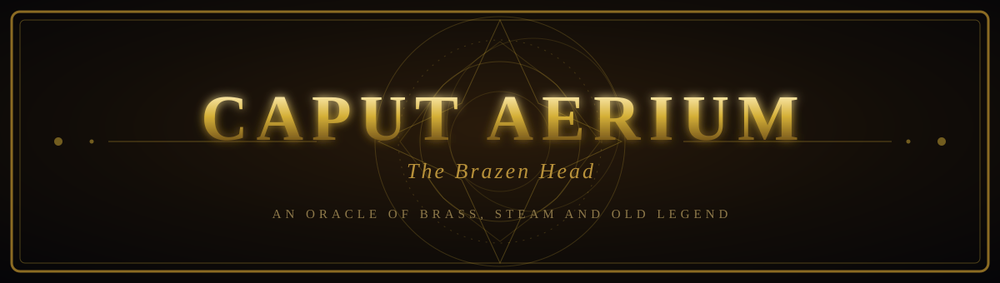
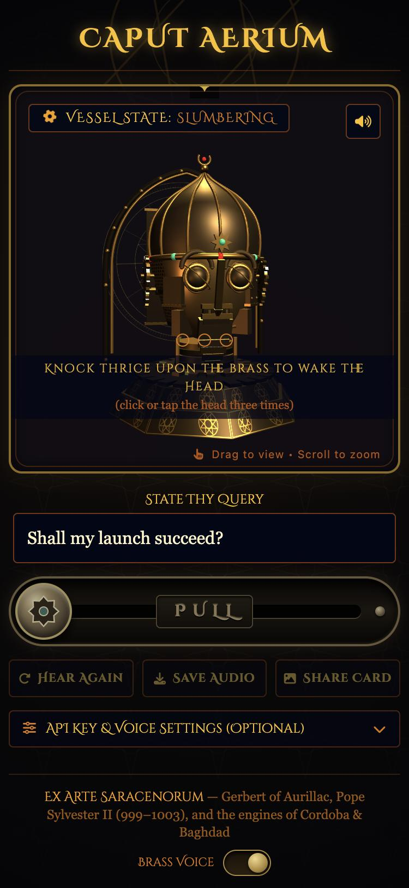
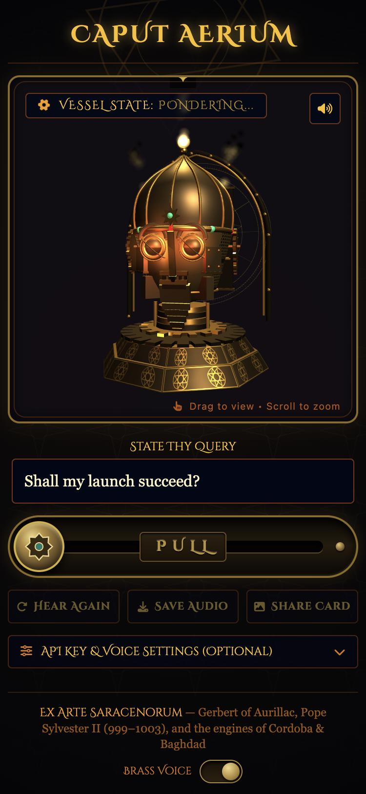
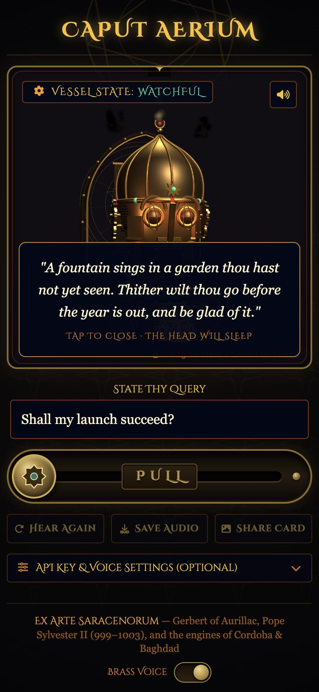
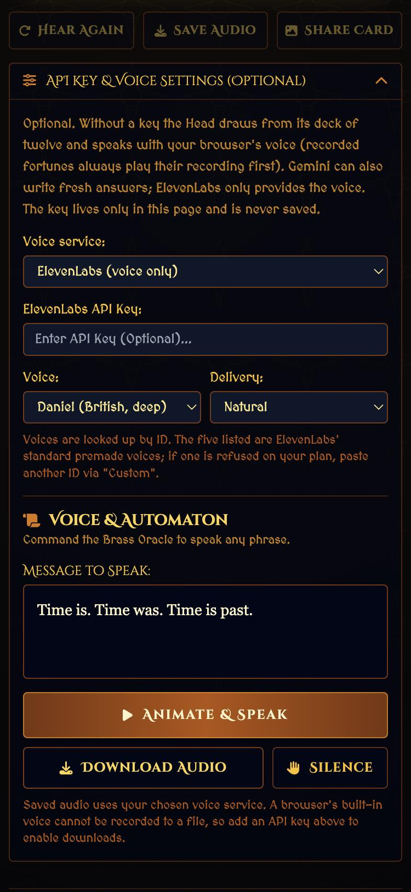
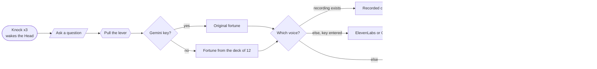

<div align="center">



### A talking head of brass that answers your questions, built as a single web page.


**[Open the oracle](https://vincentkovar.github.io/brazen-head/)** &nbsp;·&nbsp; works best on a phone &nbsp;·&nbsp; turn the sound on

</div>

---

## Knock. Ask. Pull. Listen.

<table>
<tr>
<td align="center" width="33%"><br><b>1 · It sleeps</b><br><sub>Knock three times on the brass (click or tap the head) to wake it.</sub></td>
<td align="center" width="33%"><br><b>2 · It ponders</b><br><sub>Type a question, pull the brass lever. Eyes ignite, gears spin, steam rises.</sub></td>
<td align="center" width="33%"><br><b>3 · It speaks</b><br><sub>The Head speaks in a deep brass voice, then writes the fortune. Tap it, and the Head sleeps again.</sub></td>
</tr>
</table>

The Head is a hand-built 3D automaton in the spirit of the medieval legends of the *Brazen Head*: a talking head of bronze said to answer any question. The story attached to Pope Sylvester II (Gerbert of Aurillac), who was said to have learned the craft from the scholars of Muslim Spain, and the tale of Friar Roger Bacon, whose head spoke *"Time is. Time was. Time is past"* and then shattered, are both part of this world. The look draws on early Islamic automata: onion dome, astrolabe, pointed arch, geometric star work, cams and gears.

---

## More than a toy: a promotional tool

It looks like a game, but it is a small, finished piece of **interactive branded content** that costs nothing to host and needs no server.

| If you need… | The Head gives you… |
|---|---|
| **A talking point for a launch, event or campaign** | A memorable, atmospheric page people will actually want to play with, and share. |
| **Something visitors can take away** | **Share Card**: a one-tap picture of the Head with the visitor's question and fortune on it, ready for social media. |
| **Audio you can reuse** | **Save Audio**: the spoken fortune (with the brass effect, and the bell, ticks and steam when the browser allows it) saved as a `.wav` for video, reels or podcasts. |
| **Your own message in the oracle's voice** | Replace the twelve fortunes with your own lines: slogans, product hints, riddles, clues for an alternate-reality game, quotes from your book or film. |
| **A voice that sounds like your brand** | Record your own voice actor, or plug in an **ElevenLabs** voice. The *Brass Voice* effect makes any of them sound like the machine. |
| **A kiosk or exhibit** | Open it full screen on a tablet at a stand, museum case or shop window. Nothing is collected or sent anywhere by the page itself. |
| **Zero running cost for visitors** | With recorded fortunes, no API key is needed at all. Every visitor gets the same polished experience, free. |

> **Good to know for public campaigns:** do not put an API key into the page. Anything on a public page can be read by anyone. For a public launch, use **recorded fortunes** (no keys, no per-visitor cost). Keep ElevenLabs and Gemini for private demos, events where you type the key yourself, or a version behind your own server.

---

## Choose your voice

The page works with no key at all, and gets richer when you add one. Open **API Key & Voice Settings** at the bottom of the page.

| | No key | + ElevenLabs key | + Gemini key |
|---|---|---|---|
| **Fortunes** | Deck of 12, shuffled so none repeats until all are used | Same deck | **Original fortunes written fresh** for each question, in the Head's persona |
| **Voice** | Recorded clips for every fortune; the browser's own voice for anything else | Recorded clips, then **ElevenLabs voices** for everything else: five premade voices or **any voice ID** you paste | Recorded clips, then **Gemini voices** (Fenrir, Charon, Kore, Puck, Zephyr) |
| **Brass Voice effect** | On recordings | On recordings and ElevenLabs | On recordings and Gemini |
| **Save Audio** | Recordings | Recordings and ElevenLabs | Recordings and Gemini |

<p align="center"></p>

> **Status:** recordings and ElevenLabs have been tried end to end. The Gemini integration (fresh fortunes and voices) is built but has **not yet been tested with a live key**, and Google's preview model names change over time, so expect to adjust the model name in the code. If a call fails, the page says so and falls back to the deck and the browser voice.



---

## What's inside

- **A 3D automaton** with a riveted bronze onion dome, nasal guard, armillary-ring eyes that follow your cursor and blink, a hinged jaw that follows the voice, mail neck-guard, ear gears, a camshaft and an astrolabe behind it.
- **A brass lever** you drag or tap. It slows on the way back while the Head thinks, and it jams if the Head is asleep.
- **Sound all generated in the browser:** knocks, lever clunks, a bell, clockwork ticks, plus two recorded steam sounds and a synthesised hiss. A button mutes them.
- **Steam** from the crown, shoulders and mouth.
- **The Brass Voice effect:** a lower pitch, a heavy low end, a metallic ring and a stone-hall echo, applied live. A switch in the footer turns it on or off.
- **Everything is one HTML page.** Three.js, Tailwind, Font Awesome and Google Fonts load from public CDNs. There is nothing to build.

---

## Run it

**On GitHub Pages:** *Settings → Pages → Deploy from a branch → `main` / root.* The page will appear at `https://vincentkovar.github.io/brazen-head/`.

**On your computer:** the recorded voices only load from a web address, so use a tiny local server rather than double-clicking the file:

```bash
python3 -m http.server 8000
```

then open `http://localhost:8000/`.

> Opened straight from the file system, the page still runs, but the Head falls back to a plainer voice and says so.

---

## Make it yours

Open `brazen_head_oracle_mobile.html` in any editor, or click the pencil on GitHub, and search for these names.

**Your own fortunes and recordings.** Find `FORTUNES`. Each line is a fortune and, optionally, its recording:

```js
{ text: "Thy launch shall find its crowd before the third moon.", audio: "new/fortune-13.m4a" },
```

Put the audio file in `audio/new/`. Leave `audio` out, and that fortune uses ElevenLabs, Gemini or the browser voice instead. A shuffled deck makes sure every fortune plays once before any repeats.

**The Brass Voice, by ear.** All of these are plain numbers:

| Search for | What it changes | Now |
|---|---|---|
| `wet.gain.value` | Reverb loudness | `0.19` |
| `sampleRate * 1.4` | Echo tail, in seconds | `1.4` |
| `dblMix.gain.value` | The second, slightly late voice | `0.33` |
| `combMix.gain.value` | Metallic ring | `0.22` |
| `sub.gain.value` | Deep bass boost (dB) | `4.5` |
| `low.gain.value` | Low-end boost (dB) | `6.5` |
| `chest.gain.value` | Weight that phone speakers can play (dB) | `4` |
| `brassOn ? 0.88 : 1` | Pitch drop on recordings | `0.88` |

**The ElevenLabs voices.** Find `elevenVoice` in the page and change the list of voice IDs. `ELEVEN_MODEL` sets the model.

**What Gemini writes.** Find `fetchGeminiOracle`: the system instruction there is the Head's persona. Change it to change the personality, the tone or the subject matter of the fortunes.

**The audio recordings.** `audio/new/README.txt` lists the file for each fortune. Record a fortune at a time, or a whole set separated by a few seconds of silence, and split it.

---

## Keys, privacy and cost

- API keys are typed into the page and held in memory only. They are **never saved** by the page, never written to the repo, and gone when you reload.
- The page sends your text to ElevenLabs or Google only if you enter a key for that service, and only to that service.
- Use restricted keys with spending limits. ElevenLabs charges credits per character, and the page uses one of their lower-cost *turbo* models (set by `ELEVEN_MODEL`).
- The page has no analytics and no server of its own.

---

## Files

| Path | What it is |
|---|---|
| `brazen_head_oracle_mobile.html` | The Head. This is the page. |
| `index.html` | Sends visitors to the page above, so the short link works. |
| `audio/new/` | The twelve recorded fortunes and a README for them. |
| `brazen_head_oracle_v2.html` | The earlier two-tab desktop version, kept for reference. |
| `docs/` | The banner and screenshots in this README. |
| `PROGRESS.md` | Working notes: what's done and what's next. |

---

## Credits and thanks

- 3D by [three.js](https://threejs.org/). Styling by [Tailwind CSS](https://tailwindcss.com/). Icons by [Font Awesome](https://fontawesome.com/). Type from Google Fonts: Cinzel Decorative, MedievalSharp, UnifrakturMaguntia.
- The two steam sounds come from free sound libraries.
- The old stories behind the Head: Gerbert of Aurillac (Pope Sylvester II), Roger Bacon and Friar Bungay, Albertus Magnus, Robert Grosseteste, and the long folklore of the talking head of brass.
- Built with [Claude Code](https://claude.com/claude-code).

## License

No license has been chosen yet, so all rights are reserved by the author for now. Add a `LICENSE` file before others reuse the code.
